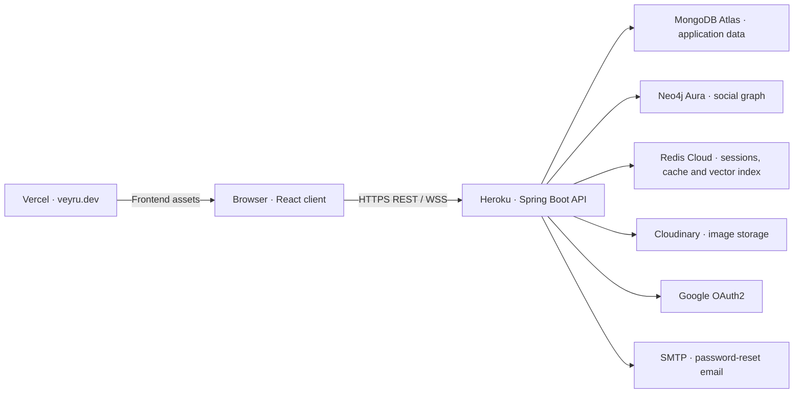

# Veyru

A personal photo-sharing project built with Java, Spring Boot and React. Veyru combines a personalized social feed, real-time conversations and cookie-based authentication.

**[Live demo — veyru.dev](https://veyru.dev)** · [Backend guide](backend/README.md) · [Frontend guide](frontend/README.md)

[](https://github.com/tphuc263/veyru/actions/workflows/ci.yml)
[](LICENSE)

To try it, create an account or sign in with Google. Find people to follow, browse your feed, and open a profile to start a conversation.


## Features

| Area | What you can do |
| --- | --- |
| Photos and interactions | Upload photos, add captions and tags, like, comment, share and save posts |
| Social feed | Follow people and browse a personalized feed of photos and shares with load-more pagination |
| Discovery | Search for people and photos, find suggested users and view related photos |
| Conversations | Exchange direct messages and receive live notifications for social activity |
| Account | Register, sign in with a password or Google, edit your profile and reset your password by email |

## Backend engineering highlights

### Personalized feed across three data stores

The feed retrieves photos and shares from MongoDB, then combines recency and engagement with relationship signals from Neo4j. Redis caches author affinity scores to avoid repeating graph queries. Signed, user-bound cursors carry the ranking time and pagination position. If graph affinity lookup fails, ranking falls back to post signals.

[Feed implementation](backend/src/main/java/com/veyru/application/discovery/NewsfeedService.java) · [Ranking and fallback tests](backend/src/test/java/com/veyru/application/discovery/NewsfeedServiceTest.java) · [Cursor tests](backend/src/test/java/com/veyru/application/discovery/FeedCursorCodecTest.java)

### Real-time messaging with duplicate suppression

Messages travel over STOMP WebSocket and are persisted in MongoDB. Before saving a message, the use case checks that both users belong to the conversation. When a client message ID is supplied, a Redis claim keyed by sender and message ID suppresses repeat processing for 24 hours. Persistence and notification delivery are separate operations; this does not provide exactly-once delivery.

[Send-message use case](backend/src/main/java/com/veyru/application/messaging/SendMessageUseCase.java) · [Redis claim](backend/src/main/java/com/veyru/adapter/out/redis/RedisMessageIdempotency.java) · [Use-case tests](backend/src/test/java/com/veyru/application/messaging/SendMessageUseCaseTest.java)

### Cookie sessions with refresh-token replay detection

Password and Google sign-in issue an access JWT and an opaque refresh token in HttpOnly cookies. Spring Security applies CSRF protection and configured browser origins. A Redis Lua script rotates refresh tokens atomically; reuse of a spent token revokes its token family. The frontend obtains its CSRF token through an API endpoint so session cookies can remain host-only.

[Refresh-token rotation](backend/src/main/java/com/veyru/adapter/out/redis/RedisRefreshSessionStore.java) · [Security configuration](backend/src/main/java/com/veyru/config/SecurityConfig.java) · [Session use-case tests](backend/src/test/java/com/veyru/application/identity/SessionServiceTest.java)

## Architecture and technology

The deployed application uses the following services:



| Layer | Technology and role |
| --- | --- |
| Backend | Java 25, Spring Boot 4.1, Spring Security; REST APIs and application use cases |
| Frontend | React 19, TypeScript/JavaScript, Vite, React Router and Axios |
| Persistence | MongoDB for users, posts, interactions and conversations; Neo4j for graph queries |
| Redis | Refresh sessions, message deduplication, affinity caching and Redis Search vector queries |
| API integration | Committed OpenAPI documents and generated TypeScript types; STOMP for live events |
| Delivery | GitHub Actions CI, Heroku backend deployment and Vercel frontend hosting |

The backend separates domain models, application use cases and ports, and adapters for HTTP, persistence and external services. See the [backend architecture](backend/README.md#architecture) for the dependency structure and data responsibilities.

Local Docker Compose runs all five application/data services. Its frontend container uses Nginx to serve assets and proxy backend requests; the Vercel deployment serves assets separately and the browser calls the Heroku API directly.

## Run locally

Requires Docker with Docker Compose v2. Java and Node.js are only needed for running the applications outside containers.

```bash
git clone https://github.com/tphuc263/veyru.git
cd veyru
cp .env.example .env
```

Fill in the Cloudinary, Google OAuth and SMTP credentials in `.env` before starting. These are required dependencies, even when you only want to explore other features. Keep the remaining local defaults for this setup. See [environment configuration](backend/README.md#environment-configuration), including the Google callback URLs.

```bash
docker compose up --build
```

| Service | Local URL |
| --- | --- |
| Application | [localhost:5173](http://localhost:5173) |
| Swagger UI | [localhost:8080/swagger-ui.html](http://localhost:8080/swagger-ui.html) |
| Neo4j Browser | [localhost:7474](http://localhost:7474) |

Stop the stack with `docker compose down`; database volumes are retained. `docker compose down --volumes` also deletes the local database data.

For development with hot reload, follow the [backend setup](backend/README.md#local-development) and [frontend setup](frontend/README.md#local-development). Compose reads the root `.env`; running Spring Boot directly uses a separate `backend/.env`.

## Testing and delivery

[CI](.github/workflows/ci.yml) runs on pull requests and pushes to `main`:

- **Backend:** Spotless formatting checks, JUnit tests including Testcontainers integration tests, and a Docker image build.
- **Frontend:** OpenAPI type checks, ESLint, Vitest/Testing Library tests, a TypeScript/Vite build, Playwright smoke tests and a Docker image build. The Playwright tests mock API responses; they do not exercise the complete deployed stack.

The [backend CD workflow](.github/workflows/cd.yml) runs after successful CI on `main`. Its change filter checks the triggering commit for backend or CD workflow changes, then builds and releases a container to Heroku. It can also be triggered manually. Frontend hosting is managed separately on Vercel.

| Documentation | Contents |
| --- | --- |
| [Backend guide](backend/README.md) | Architecture, configuration, security, deployment and test commands |
| [Frontend guide](frontend/README.md) | Local setup, Vercel variables, sessions, WebSocket and test commands |
| [Backend OpenAPI](backend/openapi/openapi.json) | Committed REST API contract |
| [Frontend contract workflow](frontend/README.md#api-contract) | Release copy and generated TypeScript types |

## Trade-offs and current limits

- **Multiple data stores:** MongoDB, Neo4j and Redis support different query patterns, but add configuration, synchronization and operational work. Graph and vector projections can lag application data.
- **Feed ranking:** The scoring weights are heuristics, and candidate retrieval is bounded. They have not been tuned through an offline relevance evaluation.
- **Real-time scaling:** Spring's simple STOMP broker runs in process. Multiple backend instances would need additional broker and user-routing coordination.
- **Recommendations:** Photo similarity uses hash-based vectors from captions and tags. Caption/tag suggestions use local rules and templates; they are not image understanding or a trained language model.

## Author and license

Built by **Duong Tri Phuc** · [GitHub](https://github.com/tphuc263)

[MIT License](LICENSE) © 2026 tphuc263
