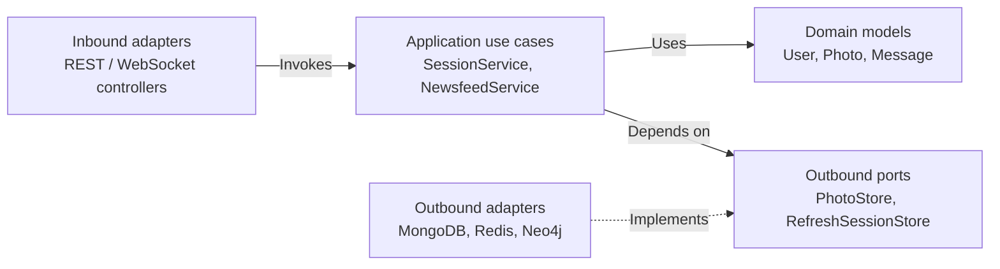
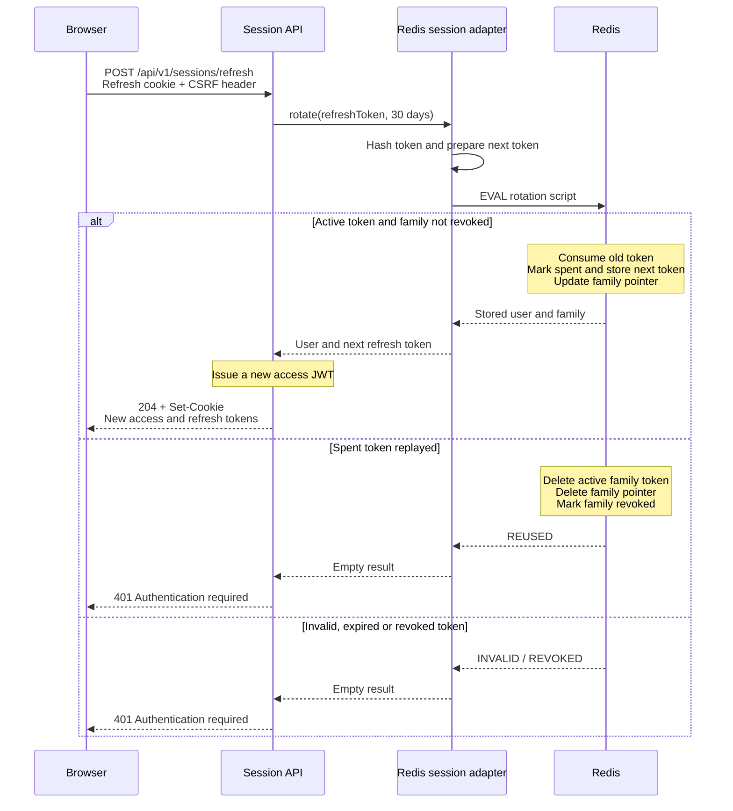

# Veyru Backend

Java 25 / Spring Boot 4.1 API for Veyru. The backend handles authentication, photo sharing, feed ranking, conversations and notifications.

[Project overview and demo](../README.md) · [Frontend guide](../frontend/README.md) · [OpenAPI contract](openapi/openapi.json)

## Architecture

The code separates business behavior from transport and storage through application ports and adapters:

| Package under `com.veyru` | Responsibility |
| --- | --- |
| [`domain`](src/main/java/com/veyru/domain) | Models, invariants and domain validation |
| [`application`](src/main/java/com/veyru/application) | Use cases for identity, media, social activity, discovery and messaging; outbound port interfaces |
| [`adapter/in`](src/main/java/com/veyru/adapter/in) | REST and WebSocket controllers, request/response mapping, security entry points and event handlers |
| [`adapter/out`](src/main/java/com/veyru/adapter/out) | MongoDB, Neo4j, Redis, Cloudinary, mail and notification implementations |
| [`config`](src/main/java/com/veyru/config) | Spring wiring, validated configuration, security and infrastructure setup |

Inbound adapters invoke application use cases. Use cases depend on outbound interfaces such as `PhotoStore`, `GraphFeedQuery` and `RefreshSessionStore`; Spring configuration wires their implementations. Application services also use selected framework facilities such as metrics and configuration records.



Arrows show code dependencies; the dashed arrow shows interface implementation. At runtime, Spring injects outbound adapters into use cases through these ports.

### Data responsibilities

| Service | Stored data or responsibility |
| --- | --- |
| MongoDB | Users, photos, follows, likes, comments, shares, conversations, messages and notifications |
| Neo4j | Social graph projections used for affinity and suggested-user queries |
| Redis | Refresh sessions and OAuth exchange codes, message deduplication, affinity/avatar caching and a photo vector index |
| Cloudinary | Uploaded image storage |
| Google OAuth2 / SMTP | Google sign-in and password-reset email |

MongoDB holds application records; graph and vector data are derived projections. Updates across these systems are not one distributed transaction.

## Local development

Requirements: **JDK 25**, Docker with Compose v2, and credentials for Cloudinary, Google OAuth and SMTP. The Maven Wrapper is included; a separate Maven installation is unnecessary.

Run these commands from `backend/`:

```bash
cp ../.env.example .env
```

Fill in the required external-service values in `backend/.env`. Keep the template's local connection values for the following setup, then start the data services:

```bash
docker compose -f ../compose.yml --env-file .env up -d mongodb redis neo4j
docker compose -f ../compose.yml --env-file .env ps
```

Once the services are healthy, start the API:

```bash
SPRING_PROFILES_ACTIVE=local ./mvnw spring-boot:run
```

The API listens on [localhost:8080](http://localhost:8080). Start the client using the [frontend instructions](../frontend/README.md#local-development).

If you already use Task CLI, `task infra` starts the same data services and `task dev` starts infrastructure followed by the API. Create and fill in `.env` first. These shortcuts are defined in [Taskfile.yml](Taskfile.yml).

To stop only the data services without removing their data:

```bash
docker compose -f ../compose.yml --env-file .env stop mongodb redis neo4j
```

For an entirely containerized application, use the [root Compose quick start](../README.md#run-locally).

## Environment configuration

The [environment template](../.env.example) lists the supported names. Do not commit credentials.

- **Compose:** reads the root `.env` and supplies environment variables to the backend container.
- **Direct local development:** the `local` profile imports `.env` from the backend working directory.
- **Public deployment:** set `SPRING_PROFILES_ACTIVE=prod` and supply values through hosting environment/secret settings. Do not deploy a `.env` file.

[Shared configuration](src/main/resources/application.yml) defines the application settings. [Local configuration](src/main/resources/application-local.yml) supplies localhost defaults; [production configuration](src/main/resources/application-prod.yml) enables graceful shutdown, secure cookies and health endpoint policy. OS environment variables override packaged YAML. Custom configuration records and startup validators reject missing or invalid required values.

| Variable | Purpose |
| --- | --- |
| `MONGODB_URI` | MongoDB URI; production requires `mongodb+srv` or a `mongodb` URI with TLS enabled |
| `REDIS_URL` | Redis connection URL, including credentials and `rediss://` when TLS is used |
| `NEO4J_URI`, `NEO4J_USERNAME`, `NEO4J_PASSWORD` | Graph connection; production requires an encrypted Neo4j/Bolt URI |
| `JWT_SECRET` | Base64-encoded signing key containing at least 32 random bytes; replace the local example in production |
| `CORS_ALLOWED_ORIGINS` | Exact comma-separated browser origins |
| `FRONTEND_URL` | Frontend URL used in application links |
| `OAUTH2_REDIRECT_URI`, `OAUTH2_FAILURE_REDIRECT_URI` | Frontend destinations after OAuth success/failure |
| `OPENAPI_SERVER_URL` | API base URL advertised by OpenAPI |
| `CLOUDINARY_CLOUD_NAME`, `CLOUDINARY_API_KEY`, `CLOUDINARY_API_SECRET` | Required image storage credentials |
| `SPRING_SECURITY_OAUTH2_CLIENT_REGISTRATION_GOOGLE_CLIENTID`, `SPRING_SECURITY_OAUTH2_CLIENT_REGISTRATION_GOOGLE_CLIENTSECRET` | Required Google OAuth credentials |
| `SPRING_MAIL_HOST`, `SPRING_MAIL_PORT`, `SPRING_MAIL_USERNAME`, `SPRING_MAIL_PASSWORD` | Required SMTP configuration; STARTTLS is enabled |

Use the canonical Google and SMTP variable names above, not the older `GOOGLE_CLIENT_*` or `MAIL_*` names. Cloudinary, OAuth and SMTP values are required at startup even if you do not use those features in a particular session.

`PORT` defaults to `8080`. Session cookies are secure in production and non-secure for local HTTP. `GRAPH_RECONCILE_ON_STARTUP` defaults to `false`.

### Redis Search requirement

Vector indexing is always enabled. Redis must support `FT.CREATE` and `FT.SEARCH`; the local Compose service uses Redis Stack. A plain Redis service without Search fails vector-index initialization and prevents startup. Ensure the Redis Cloud database supports these commands.

After startup, related-photo queries can fall back to tag matching when vector operations fail. This is a feature-level fallback: Redis is also required for refresh sessions and message deduplication, so it does not make the entire application resilient to a Redis outage.

### Google OAuth callbacks

Register the callback matching how the browser reaches the backend:

| Setup | Authorized redirect URI in Google OAuth settings |
| --- | --- |
| Vite frontend calling the API directly | `http://localhost:8080/login/oauth2/code/google` |
| Deployed API | `https://api.veyru.dev/login/oauth2/code/google` |

These backend callbacks differ from `OAUTH2_REDIRECT_URI`, which sends the browser back to the frontend after backend sign-in completes.

For local Google sign-in, use the direct Vite/API setup above. The current Compose Nginx proxy forwards `$host` without the external port, so Spring's generated callback may omit port 5173. Proxied OAuth needs the external host and port forwarded correctly before registering a callback on that port.

## Core behavior and limits

### Feed and discovery

[`NewsfeedService`](src/main/java/com/veyru/application/discovery/NewsfeedService.java) merges MongoDB photos and shares from followed users and the viewer, retrieves Neo4j affinity signals, and scores candidates using recency, engagement and caption/tag signals. Affinities are cached for five minutes by default. If the cache fails, the service attempts a graph lookup; if that fails, it uses post-only ranking.

[`FeedCursorCodec`](src/main/java/com/veyru/application/discovery/FeedCursorCodec.java) signs the viewer ID, ranking time and last position. Cursors expire after five minutes by default. Candidate retrieval is capped at 200 by default; ranking is recalculated per request, rather than materializing an immutable feed snapshot. Weights and limits live in `newsfeed` configuration.

[`RecommendationService`](src/main/java/com/veyru/application/discovery/RecommendationService.java) uses graph queries for people discovery and Redis vector queries for related photos. Photo vectors are 128-dimensional, locally hashed representations of caption/tag text. The [`AIService`](src/main/java/com/veyru/application/intelligence/AIService.java) uses rules, templates and posting history for suggestions; it does not perform learned image analysis or call an external AI model.

### Messaging

[`SendMessageUseCase`](src/main/java/com/veyru/application/messaging/SendMessageUseCase.java) validates conversation membership before saving a message and notifying participants. A supplied client message ID is claimed in Redis with a 24-hour TTL, scoped to the sender. Requests without an ID do not use this duplicate check.

The claim, MongoDB writes and WebSocket notification are separate operations. A failure after claiming an ID can suppress a retry with that ID until expiry. This is duplicate suppression, not a transactional or exactly-once delivery guarantee.

The `/ws` endpoint uses STOMP with Spring's in-process simple broker. Scaling across backend instances requires additional coordination for broker delivery and user destinations.

### Sessions and browser security

- Access JWTs last 15 minutes; opaque refresh tokens have a 30-day lifetime. Both are stored in HttpOnly, `SameSite=Lax`, host-only cookies, with `Secure` enabled in production.
- [`RedisRefreshSessionStore`](src/main/java/com/veyru/adapter/out/redis/RedisRefreshSessionStore.java) stores hashed token identifiers and uses Lua to rotate tokens atomically. Reusing a spent refresh token revokes the token family. Already-issued access JWTs retain their own expiry.
- Google sign-in returns a short-lived, single-use exchange code to the frontend, which exchanges it for session cookies.
- The client fetches `GET /api/v1/csrf` and sends `X-XSRF-TOKEN` with REST mutations and STOMP `CONNECT`. It does not need to read a cookie from the API subdomain.
- Browser requests use an explicit CORS origin allowlist with credentials enabled.

#### Refresh-token rotation and replay detection

The sequence below follows a refresh request after CSRF validation. The Redis adapter prepares the next token, then executes the state transition atomically in Lua.



Malformed token families are rejected before calling Redis. Replay detection depends on the spent-token marker, retained for 30 days after rotation. Revoking a refresh-token family does not invalidate access JWTs that have already been issued; they expire independently.

## Production deployment

The deployed backend runs as a container on Heroku, with MongoDB Atlas, Neo4j Aura and Redis Cloud. Set the required credentials above through Heroku configuration and use these public URL settings:

```dotenv
SPRING_PROFILES_ACTIVE=prod
CORS_ALLOWED_ORIGINS=https://veyru.dev
FRONTEND_URL=https://veyru.dev
OAUTH2_REDIRECT_URI=https://veyru.dev/auth/oauth2/redirect
OAUTH2_FAILURE_REDIRECT_URI=https://veyru.dev/login?error=true
OPENAPI_SERVER_URL=https://api.veyru.dev
AUTH_COOKIE_SECURE=true
```

The production validator rejects localhost dependencies, non-HTTPS browser URLs, insecure MongoDB/Neo4j connections and non-secure session cookies. Configure the frontend separately using the [Vercel settings](../frontend/README.md#vercel-deployment).

The [CD workflow](../.github/workflows/cd.yml) builds a `linux/amd64` backend image, pushes it to Heroku Container Registry and releases the web container. It requires the repository secrets `HEROKU_API_KEY` and `HEROKU_APP_NAME`. Automatic runs follow successful CI on `main` and a change filter on the triggering commit; manual dispatch is also supported.

### Health and diagnostics

| Endpoint | Production behavior |
| --- | --- |
| `/actuator/health/liveness` | Checks application liveness without data-service checks; used by the Docker health check |
| `/actuator/health/readiness` | Includes readiness state, MongoDB and Redis; use for hosting readiness checks |

Readiness does not verify Neo4j, Cloudinary, Google OAuth or SMTP. Feed/cache timings and recommendation fallback counters are recorded through Micrometer. `/actuator/metrics` is configured in the shared profile, but production exposes only health over HTTP.

## API contract

With the API running locally, open [Swagger UI](http://localhost:8080/swagger-ui.html). The committed contract is [`openapi/openapi.json`](openapi/openapi.json). The frontend keeps a release copy and generates TypeScript types from it; see the [contract update workflow](../frontend/README.md#api-contract).

## Checks

From `backend/`, with JDK 25 and Docker running:

```bash
./mvnw spotless:check test
```

Tests cover domain rules, application use cases, controllers, security/configuration and adapters. Testcontainers tests start actual Neo4j and Redis containers, so Docker and access to their images are needed for the complete suite. Session use-case tests verify orchestration with mocked ports.

To check container packaging separately:

```bash
docker build -t veyru-backend .
```

The Dockerfile skips tests during packaging; CI runs the Maven checks before building the image.
